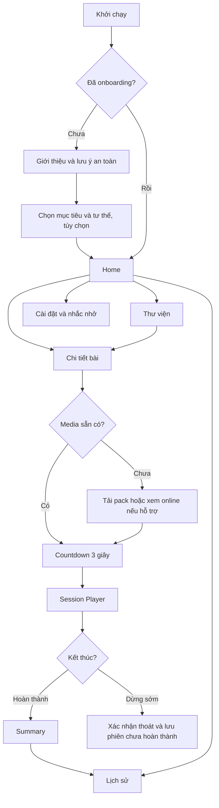

# PRD — AN NHIÊN | Dưỡng sinh mỗi ngày

**Phiên bản:** 1.1 · **Ngày:** 18/10/2026 · **Nền tảng:** Flutter (Android & iOS) · **Trạng thái:** Đặc tả MVP để triển khai

## 0. Tóm tắt quyết định

- **Định vị:** Ứng dụng wellness/dưỡng sinh nhẹ, hướng dẫn người dùng tập tại nhà theo video và hình động, không phải ứng dụng chẩn đoán hay điều trị.
- **Giá trị chính:** Trong tối đa 3 thao tác từ màn Home, người dùng có thể bắt đầu một bài tập phù hợp và được hướng dẫn theo từng động tác với giao diện dễ đọc, timer rõ ràng, lời dẫn tiếng Việt.
- **Khách hàng đầu tiên:** Người trưởng thành, đặc biệt người ít vận động, làm việc văn phòng, người trung niên muốn tập nhẹ; hỗ trợ người thích bài tập đứng hoặc ngồi.
- **Ngôn ngữ:** Tiếng Việt đầu tiên; dữ liệu nội dung và UI đã sẵn sàng cho i18n, nhưng bản MVP chỉ có vi-VN.
- **Stack:** Flutter + Dart, Material 3 tùy biến; Riverpod; go_router; video_player; just_audio + audio_session (khi cần tách track); Rive (chỉ khi có asset đã duyệt); Drift/SQLite; flutter_local_notifications; path_provider và cơ chế download/lưu file bền vững.
- **Local-first, CMS-ready:** Không đăng nhập, không backend/CMS, không đồng bộ đám mây ở MVP. Catalog là dữ liệu Git-managed theo schema/version, truy cập qua ContentCatalogRepository (sẵn sàng cho remote source trong tương lai). Lịch sử và cài đặt lưu cục bộ. Một bài khởi đầu ngắn phải chạy được khi cài mới mà không có mạng; các bài còn lại có thể tải pack để dùng offline.
- **An toàn:** Mọi nội dung bài tập cần người có chuyên môn vận động/y tế đánh giá trước phát hành. Không suy đoán bệnh, không thiết lập phác đồ cá nhân từ triệu chứng. Không khuyến khích tác động sâu vùng cổ trước/xoang cảnh, nín thở hay gắng sức.

## 1. Vấn đề và cơ hội

Nội dung dưỡng sinh trên video dài khó điều khiển: người dùng phải tìm đúng đoạn, không biết còn bao lâu, không có cách tập nhanh theo nhu cầu, và mạng yếu dễ gây gián đoạn. Nhiều ứng dụng luyện tập lại thiết kế cho tập nặng, số lượng thông tin lớn, chữ nhỏ và tương tác phức tạp.

**Giả thuyết sản phẩm:** Một trình hướng dẫn từng bước với video/người thật, hỗ trợ động tác 2D nhẹ, giọng đọc rõ, bài ngắn, và chế độ offline sẽ giúp người dùng hoàn thành các phiên tập nhẹ đều đặn hơn so với danh sách video truyền thống. Giả thuyết phải đo bằng nghiên cứu người dùng, không coi là kết quả đã chứng minh.

## 2. Mục tiêu / phi mục tiêu

### 2.1 Mục tiêu P0

1. Onboarding tối đa 3 màn, nêu mục đích wellness và lưu ý an toàn; bỏ qua được hồ sơ cá nhân.
2. Xem 5 routine đã được kiểm duyệt về nội dung và 7 exercise cơ bản; có lọc bài đứng/ngồi, thời lượng, mục tiêu.
3. Vào Session Player và tập tuần tự, có play/pause, trước/sau, hướng dẫn chữ + phụ đề/lời dẫn, tiến độ tổng, cảnh báo dừng tập.
4. Bài khởi đầu hoạt động ngay khi cài mới không có Internet; có quản lý download pack cho các bài còn lại, xác thực file và thông báo dung lượng.
5. Lưu lịch sử hoàn thành, tổng phút luyện tập, mục tiêu nhắc nhở cục bộ (tùy chọn và chỉ sau khi người dùng đồng ý).
6. Trải nghiệm dễ tiếp cận: chữ lớn theo cài đặt OS, đối tượng bấm >= 48dp, tương phản đủ cao, TalkBack/VoiceOver, tùy chọn giảm chuyển động.

### 2.2 Không làm trong MVP

- AI tạo bài tập / tư vấn bệnh / chẩn đoán / lời hứa chữa tê tay chân, tăng huyết áp, mất ngủ.
- Camera nhận diện tư thế, smartwatch, Apple Health/Google Health Connect.
- Đăng nhập, cloud sync, social feed, gamification gây áp lực, quảng cáo hoặc thanh toán.
- Streaming HLS bắt buộc, background audio player, tập qua lock screen.
- Công cụ CMS online và remote catalog synchronization; nội dung khởi đầu nằm trong manifest JSON có schema/version được lưu trong Git. Giữ extension point để kết nối CMS/CDN sau MVP.

## 3. Personas và tình huống

| Persona | Nhu cầu | Rào cản | Quyết định UX |
|---|---|---|---|
| Người làm việc văn phòng 25–45 | Nghỉ ngắn, thư giãn sau ngồi lâu | Thời gian ngắn | Bài 6–10 phút; bắt đầu nhanh |
| Người trung niên 45–70 | Vận động nhẹ sáng/chiều | Chữ nhỏ, thao tác phức tạp | Large controls, voice hướng dẫn, giảm hiệu ứng |
| Người thích tập trên ghế | Không muốn đứng lâu | Cân bằng không tốt | Bộ lọc và nhãn rõ 'Ngồi' |
| Người mạng yếu | Tập không gián đoạn | Video buffering | Pack offline, chỉ báo chưa tải |

Không phân loại rủi ro y tế hay cho phép tập dựa vào câu trả lời sức khỏe; chỉ nêu cảnh báo và khuyến nghị tham vấn chuyên môn khi có vấn đề cần đánh giá.

## 4. Nội dung khởi đầu

Đây là danh mục sản phẩm đề xuất, **không phải chỉ định y khoa**. Thời lượng cuối cùng phụ thuộc video đã duyệt.

| ID | Routine | Thời lượng mục tiêu | Tư thế | Nội dung |
|---|---|---:|---|---|
| R01 | Khởi động nhẹ | 6 phút | Ngồi / đứng có hỗ trợ | Thở tự nhiên, vai, bàn tay/cổ chân, thư giãn |
| R02 | Dưỡng sinh sáng | 14 phút | Đứng + ngồi | 7 động tác trong danh mục E01–E07 |
| R03 | Thư giãn cổ vai | 8 phút | Ngồi | Vận động vai/bả vai, thả lỏng; **không day vùng trước cổ** |
| R04 | Dưỡng sinh trên ghế | 10 phút | Ngồi | Tay, chân, vai, thở tự nhiên |
| R05 | Thư giãn buổi tối | 6 phút | Ngồi | Nhịp chậm, chuyển động nhẹ, thư giãn |

**Danh mục 7 exercise:** E01 Thở tự nhiên; E02 Xoay vai; E03 Nắm mở bàn tay + cổ chân; E04 Nâng hạ hai tay; E05 Chuyển trọng tâm (có điểm tựa); E06 Bước tại chỗ (có điểm tựa); E07 Ngồi thư giãn.

Mỗi exercise cần: `id`, `title`, `position`, `focus`, `intensity`, `defaultDurationMs`, `instructions[]`, `cues[]`, `safetyNotes[]`, `stopConditions[]`, `media[]`, `reviewStatus`, `reviewedByRole`, `reviewedAt`, `contentVersion`. Media cần `kind`, `localAssetPath`/`downloadUrl`, `durationMs`, `checksumSha256`, `captionTrack`, `locale`, `poster`, `fileBytes`, `accessibilityDescription`. Không xuất bản khi `reviewStatus != approved`. **Manifest thực tế và bộ ảnh tách rời**: `catalog/catalog.draft.v1.json`, `catalog/catalog.schema.v1.json`, `assets/series/E01..E07`; hướng dẫn `05_Content_Catalog_And_Series.md`. Ảnh AI luôn `demoOnly=true`, `reviewStatus=draft`, chưa có hướng dẫn video chính thức.

## 5. Luồng người dùng



### 5.1 Các màn hình

| Mã | Màn hình | Nội dung chính | CTA / trạng thái |
|---|---|---|---|
| S01 | Onboarding | Giá trị app + mục tiêu + tư thế, lưu ý wellness | Tiếp tục / Bỏ qua |
| S02 | Home | Bài hôm nay, bắt đầu nhanh, phần tiếp theo, lịch tập | Bắt đầu |
| S03 | Thư viện | Bộ lọc mục tiêu, ngồi/đứng, thời lượng, offline | Xem bài |
| S04 | Chi tiết routine | Poster, mô tả, thời lượng, danh sách bước, cảnh báo | Bắt đầu / Tải bài |
| S05 | Kiểm tra trước tập | Không gian tập, ghế chắc chắn nếu cần, lưu ý dừng tập | Tôi đã đọc, bắt đầu |
| S06 | Session Player | Media chính, tên bước, lời dẫn, thời gian, controls | Play/Pause/Next/Prev/Dừng |
| S07 | Pause/Exit sheet | Tạm dừng, tiếp tục, thoát | Tiếp tục / Kết thúc sớm |
| S08 | Summary | Hoàn thành, phút thực tập, ghi chú nhẹ tùy chọn | Về Home / Xem lịch sử |
| S09 | Tiến độ | Lịch sử tập, tổng số phút, số buổi | Chi tiết phiên |
| S10 | Cài đặt | Âm thanh, cỡ chữ theo OS, giảm chuyển động, nhắc nhở, quyền riêng tư | Lưu cài đặt |
| S11 | Offline packs | Trạng thái tải bài, dung lượng, retry/delete | Tải / Xóa |
| S12 | Safety / trợ giúp | Quy tắc an toàn và dấu hiệu cần dừng | Xác nhận |

## 6. Yêu cầu chức năng và tiêu chí nghiệm thu

### F01 — Onboarding & quyền riêng tư (P0)
- Given lần đầu mở ứng dụng, When xem onboarding, Then có thể tiếp tục mà không nhập thông tin bệnh lý, tên, tài khoản.
- Given chưa đồng ý notification, When mở app, Then không tự xin quyền; chỉ xin khi bật nhắc nhở.
- Given người dùng chọn tư thế 'ngồi', When vào Home, Then đề xuất bài có nhãn 'ngồi' nhưng không khóa toàn bộ bài khác.

### F02 — Catalog (P0)
- Có tối thiểu 5 routine metadata, 7 exercise, tìm/lọc cơ bản; tất cả tên và hướng dẫn tiếng Việt.
- Trạng thái `preview/draft/approved/retired`; chỉ `approved` hiển thị bình thường.
- Catalog được đọc qua repository từ JSON Git-managed có schema/version, không hardcode exercise/routine trong widget. Thêm ID mới chỉ cần dữ liệu/media; bản MVP vẫn cần cập nhật app để phân phối nội dung mới.
- Catalog hiển thị khi offline; chưa có media phải có nhãn 'Cần tải', không tạo nút Start hỏng.

### F03 — Player (P0, quan trọng nhất)
- Countdown 3 giây trước khi phát. Có play/pause, next/prev, hiển thị bước n/N, `mm:ss` bước hiện tại và tổng.
- Khi người dùng pause, video/animation/audio/timer đều pause; resume không bị nhân đôi cue.
- Khi video buffer, đồng hồ bài không chạy trước nội dung phát; nếu media lỗi, hiển thị Retry hoặc Skip, không silently complete.
- Khi có điện thoại gọi, audio focus loss, chuyển background hoặc mất kết nối với media online, app pause một cách an toàn. Quay lại phải có thao tác tiếp tục chủ động.
- Khi dừng sớm, phiên ghi `abandoned` hoặc `interrupted`, không tính như `completed`.
- Tôn trọng reduced-motion; caption độc lập với audio; luôn có nút dừng lớn và dễ tìm.
- Khi chuyển video sang bài mới, tránh phát hai track giọng đồng thời; không autoplay bài khi media chưa `ready`.

### F04 — Media & offline (P0)
- R01 có thể phát ngay offline sau khi cài app. R02–R05 có thể tải hoàn chỉnh và dùng khi không có mạng.
- Download pack gồm manifest + assets, tải vào temp, kiểm tra kích thước/hash SHA-256 rồi mới đánh dấu sẵn sàng; tải hỏng giữ bản cũ, hỗ trợ retry.
- Có hiển thị `notDownloaded/downloading/ready/error`, dung lượng, tiến trình, và confirm trước khi xóa.
- Thông tin bản quyền/quyền sử dụng media có sẵn trong content manifest.
- Trạng thái completed và settings vẫn tồn tại khi restart app.

### F05 — Progress & reminders (P0)
- Khi buổi tập hoàn tất đúng logic, ghi `sessionId`, `routineId`, `contentVersion`, `startedAt`, `finishedAt`, `actualActiveSeconds`, `status`.
- Không cộng thời gian pause hoặc buffer vào phút tập tích cực.
- Cho phép thiết lập một reminder vào khung giờ do người dùng chọn; quản lý quyền/không được cấp quyền rõ ràng; chỉ thông báo local.
- Không hiển thị streak gây áp lực hoặc dùng thông báo về bệnh/triệu chứng.

### F06 — Accessibility & resilience (P0)
- Các vùng bấm >=48dp; hoạt động ở text scale 200%, máy màn hình nhỏ, dark/light nếu áp dụng.
- UI không được mã hóa vai trò chỉ bằng màu. VoiceOver/TalkBack đọc đúng thứ tự, trạng thái player và hành động của nút.
- Không khóa orientation tùy tiện; nếu media landscape cần bố cục thay thế. Mọi thao tác quan trọng có text bên cạnh biểu tượng.
- Có error/empty/loading state và retry thực sự.

## 7. Thiết kế trải nghiệm & design system

**Phong cách:** bình tĩnh, rõ ràng, ít kích thích; dùng typography lớn hơn app fitness điển hình. Palette chỉ là đề xuất khởi đầu, phải token hóa thay vì viết mã màu trực tiếp trong widget.

- Tách `primitive palette` khỏi `semantic tokens`: `surface`, `surfaceElevated`, `textPrimary`, `textSecondary`, `border`, `accent`, `onAccent`, `danger`, `warning`, `success`, `focusRing`.
- Khoảng cách dùng hệ 4/8pt; bo góc vừa phải; hình ảnh động không chạy liên tục ngoài màn Player.
- Cỡ chữ đề xuất: title 24–28sp, body 16–18sp, nhãn quan trọng >=14sp; không ép hệ số font tối đa thấp hơn cài đặt trợ năng OS.
- Player dùng media 16:9 trên cùng, bên dưới là câu hướng dẫn một dòng hoặc hai dòng, thời gian dễ nhìn và controls luôn hiển thị.
- Có toggle 'Giảm chuyển động'; hiệu ứng chuyển cảnh sẽ đơn giản hóa, **nhưng không tự động xóa nội dung hướng dẫn thiết yếu** — có tùy chọn video tĩnh/caption thay thế.

## 8. Kiến trúc kỹ thuật Flutter

### 8.1 Nguyên tắc
- Feature-first structure, phân tách `presentation`, `application/domain`, `data` theo mức cần thiết, không over-engineer.
- MVVM: Widgets chỉ render / interaction; Riverpod Notifier/ViewModel quản lý state; Repository là nguồn dữ liệu duy nhất.
- Immutable models, serialization có version, lỗi được biểu diễn rõ; dependency injection qua Provider.
- Offline-first: catalog và history dùng local source-of-truth; không đặt network calls trong build method; media binary là file được quản lý và xác thực riêng.

### 8.2 Modules
```
lib/
  app/ (app.dart, router.dart, theme/, localization/)
  core/ (errors/, result/, clock/, accessibility/, logging/, media/)
  features/
    onboarding/ (presentation/, application/, data/)
    catalog/ (presentation/, application/, data/)
    routine/ (presentation/, application/, data/)
    session/ (presentation/, application/, domain/, data/)
    downloads/ (presentation/, application/, data/)
    history/ (presentation/, application/, data/)
    settings/ (presentation/, application/, data/)
    safety/ (presentation/, data/)
  data/local/ (database.dart, daos/, migrations/)
assets/ (catalog/, poster/, audio/, starter_media/, animations/)
test/; integration_test/
```

### 8.3 Chính sách thời gian phát
- `SessionState`: `idle → preparing → countdown → playing ↔ paused`, có nhánh `buffering`, `completed`, `abandoned`, `error`.
- **Video mode:** vị trí `video_player` của đoạn media là nguồn thời gian chính cho bước; buffering phải dừng tiến trình bước. Voice được ghép trong video là giải pháp ít rủi ro lệch tiếng nhất. Subtitle lấy từ timed captions; mute qua video volume.
- **Animation mode:** một đồng hồ monotonic cho `elapsed` làm nguồn chân lý; cue audio và instruction bám offset từ timeline này. Pause/resume cập nhật base time, không tích lũy tick `Timer.periodic` tùy tiện.
- Nếu phải dùng track audio riêng, dùng `audio_session` phối hợp `just_audio`, có offset cue, chính sách pause/focus và kiểm thử độ lệch; không cho video tự phát âm đồng thời với voice độc lập.
- Chỉ giữ tối đa số controller cần thiết; preload bước kế tiếp có giới hạn bộ nhớ, dispose đúng khi rời màn.

### 8.4 Offline packs
- R01 media ngắn nén sẵn trong app, nhưng không làm gói cài tăng quá mức; cần đo dung lượng thực tế trước phát hành.
- Các bài khác đi qua manifest `packId`, `contentVersion`, `files[{path,bytes,sha256,mime}]`, `downloadedAt`.
- Download temp → hash validate → atomic promote to ready directory → DB commit; khôi phục sau app bị kill.
- Bản cập nhật nội dung không phá session đang chạy; pin phiên đang dùng vào contentVersion cũ cho đến khi kết thúc.

### 8.5 Content catalog (CMS-ready, không CMS trong MVP)

- Mỗi `Exercise`, `Routine`, `RoutineStep`, `MediaAsset` là record dữ liệu độc lập, có stable ID/version. UI render danh sách và media từ repository, không hardcode.
- Gói đầu chứa **7 series ảnh độc lập (E01–E07)**, mỗi series có `storyboard.png`, `thumbnail.png`, `series_strip.png` và các khung hình `frames/NN.png`. Xem `05_Content_Catalog_And_Series.md`.
- Dùng JSON schema v1 và script `validate_catalog.py` kiểm tra duration, unique key, references, hashes, publish gate. Dữ liệu khởi đầu là **draft/demo**, không được tự gắn `approved`.
- `ContentCatalogRepository` và `CatalogDataSource` tách interface khỏi `BundledCatalogDataSource`; `RemoteCatalogDataSource`/CMS nằm ngoài phạm vi MVP. Khi bổ sung sẽ dùng validated manifest + atomic promotion + version pinning.
- Cần lưu content snapshot/version cho session; không silently sửa routine version đã phát hành. Future publishing phải qua quy trình kiểm duyệt và giấy phép media.
- **Theme cập nhật:** xanh lá đậm/teal dịu kết hợp nền kem; token hóa, không hardcode. Mẫu tham khảo: `#073F3B`, `#0A5249`, `#FAF9F3`; kiểm tra WCAG cho từng ngữ cảnh.

### 8.6 Dữ liệu
```
Routine(id, version, title, description, durationMs, position, tags, status)
Exercise(id, version, title, position, durationMs, instructions, safetyNotes, status)
RoutineStep(id, routineId, orderIndex, exerciseId, durationMs, mediaVariantId, cues)
MediaAsset(id, version, kind, locale, uri, sha256, fileBytes, captionsUri, license)
DownloadPack(packId, version, state, localRoot, downloadedAt, lastError)
WorkoutSession(id, routineId, version, startedAt, endedAt, activeSeconds, status)
Preferences(locale, voiceEnabled, captionsEnabled, reducedMotion, positionPreference)
Reminder(id, enabled, localTime, weekdays, notificationId)
```
Không lưu câu trả lời về bệnh lý ở bản MVP. Nếu sau này cần, phải thêm cơ chế đồng ý, bảo vệ dữ liệu, retention và rà soát pháp lý.

## 9. An toàn nội dung & chính sách sản phẩm

1. App là nội dung wellness, không tuyên bố chữa tê, huyết áp hoặc bệnh lý thần kinh, không tự động khuyến nghị dựa trên thuốc/triệu chứng.
2. Từng động tác có checklist kiểm duyệt: tư thế, tốc độ, lặp lại, lời dẫn, cảnh báo, phương án ngồi, caption. Có tên vai trò chuyên gia và ngày duyệt.
3. Tránh nội dung khuyến khích ấn sâu cổ trước/dưới góc hàm, kích thích xoang cảnh, bẻ/giật cổ, nín thở, tăng thông khí, giữ tư thế gây đau.
4. Màn preflight nhắc: tập ở không gian an toàn; dùng ghế chắc nếu cần; dừng khi đau ngực, khó thở, choáng, yếu/tê mới hoặc tăng lên; triệu chứng nghiêm trọng cần cấp cứu.
5. Người dùng có thể thoát ngay; không cưỡng ép hoàn tất hoặc thúc đẩy tập khi khó chịu.
6. Không gán icon 'đạt chuẩn y khoa' trừ khi thực sự có quy trình đánh giá và quyền đưa claim.
7. Có đường dẫn feedback báo lỗi động tác; nội dung được thu hồi bằng phiên bản cập nhật ứng dụng trong MVP local-only.

## 10. Chỉ số & giả thuyết thành công

Các số sau là **ngưỡng mục tiêu nội bộ đề xuất để thử nghiệm**, không phải dữ liệu thực tế.

| Mục tiêu | Định nghĩa | Target pilot |
|---|---|---|
| Time to First Session | Thời gian từ Home đến countdown | <= 20 giây, media đã tải |
| Session Completion | Phiên completed / phiên started | >= 70% trong pilot tự nguyện |
| Playback Reliability | Phiên không có crash, kẹt media hoặc timer drift nghiêm trọng | >= 99% |
| Offline Reliability | Bài đã tải phát trọn vẹn khi airplane mode | 100% bài kiểm thử |
| Accessibility | Các kịch bản chính qua screen reader/textScale 200% | 100% checklist P0 |
| Safety Content | Media được chuyên gia duyệt trước phát hành | 100% |

Không tích hợp SDK analytics bên thứ ba ở MVP. Nếu muốn đo số liệu hành vi ở pilot, sử dụng bản debug với sự đồng ý rõ ràng hoặc tổng hợp từ log do tình nguyện viên xuất ra; không gửi thông tin sức khỏe mặc định.

## 11. Kiểm thử & release gates

**Unit:** routine duration aggregation, state transitions, seek/pause/resume, monotonic time conversion, download manifest validator, session status, local notification schedule, DAO migrations.

**Widget/golden:** Home, Library, Detail, Player, Exit sheet, Summary; textScale 1.0/1.5/2.0; semantic labels; reduced motion; màn nhỏ; trạng thái offline, loading, error.

**Integration thật:** airplane mode, đổi Wi-Fi giữa buổi, nhận cuộc gọi, cắm/rút tai nghe, khóa màn hình, app background/resume, Android back gesture, iOS swipe back, thiết bị thiếu bộ nhớ, thiết bị lưu trữ gần đầy, file tải hỏng, app bị kill khi tải.

**P0 release gate:** `flutter analyze` sạch; `flutter test` pass; integration kiểm thử trên ít nhất 1 Android tầm trung và 1 iPhone; không crash P0; không có placeholder media giả làm hướng dẫn thật; 5 routine có thể chơi hết; 100% nội dung đã duyệt.

## 12. Kế hoạch triển khai theo vertical slice

1. **Foundation:** theme tokens, typography, go_router, Riverpod, content models, local DB, localization.
2. **One golden path:** S02 Home → S04 Detail → S05 Preflight → S06 Player → S08 Summary cho R01, chạy offline.
3. **Real media:** plugin video/voice, audio focus, pause/buffering/background, captions, content validation.
4. **Scale catalog:** 5 routines, Library filters, Offline packs, download error handling.
5. **Retention:** History, optional reminders, accessibility audits, E2E tests.
6. **Review & release:** thử với người dùng thật, kiểm duyệt tư thế, build Android/iOS, kiểm tra giấy phép nội dung.

## 13. Những quyết định cần validate trước production

- Chi phí sản xuất video người thật và việc sở hữu quyền khai thác thương mại.
- Format media chuẩn cho máy Android thấp, caption tiếng Việt, phân phối offline pack.
- Lời dẫn tích hợp trong video hay cue âm thanh riêng cho từng mode; quyết định cuối dựa vào test đồng bộ.
- Khả năng chạy media Rive thật trên thiết bị thấp; dùng ảnh tĩnh/video nếu lỗi hoặc người dùng bật reduced motion.
- Nội dung cụ thể từng động tác phải được kiểm duyệt, không lấy hình ảnh demo/AI chưa duyệt làm bài tập phát hành.

## 13.1 Bộ asset minh họa MVP

Các hình AI tông xanh đậm được tách thành **7 series**, tổng 30 frames, thứ tự chuỗi R02: E01 → E02 → E03 → E04 → E05 → E06 → E07 = **14 phút**. Đây là asset **design/dev preview**, không phải video/animation đã kiểm duyệt. Một số pose mô phỏng cần chuyên gia đánh giá/sửa trước release. `05_Content_Catalog_And_Series.md` là nguồn mô tả chi tiết về path, schema, import, licensing và các release gates.

## 14. Tham khảo kỹ thuật (kiểm tra lại trước khi cài package)

- Flutter app architecture: https://docs.flutter.dev/app-architecture/guide
- Flutter offline-first: https://docs.flutter.dev/app-architecture/design-patterns/offline-first
- Flutter accessibility: https://docs.flutter.dev/ui/accessibility
- Flutter video_player: https://pub.dev/packages/video_player
- Flutter Riverpod: https://pub.dev/packages/flutter_riverpod
- go_router: https://pub.dev/packages/go_router
- just_audio / audio_session: https://pub.dev/packages/just_audio · https://pub.dev/packages/audio_session
- Drift: https://pub.dev/packages/drift · https://pub.dev/packages/drift_flutter
- Rive: https://pub.dev/packages/rive

---
**Owner:** Chưa chỉ định · **Phê duyệt nội dung vận động:** Bắt buộc trước khi xuất bản · **Tài liệu liên quan:** `03_Wireframe_Spec.md`, `02_Claude_Code_Flutter_Prompt.md`, `05_Content_Catalog_And_Series.md`
